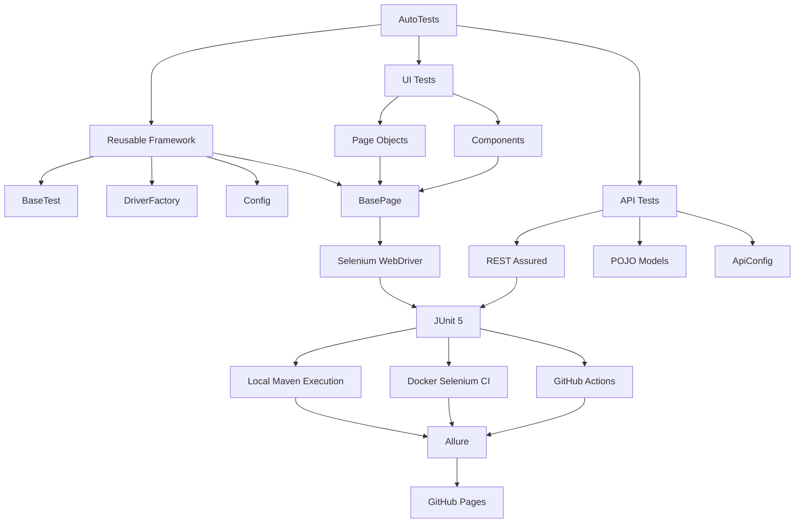

# AutoTests


Java-проект по автоматизации тестирования, демонстрирующий UI- и API-тестирование, использование Page Object Model, переиспользуемых компонентов фреймворка, категоризацию тестов, запуск в Docker, CI/CD через GitHub Actions и формирование отчётов Allure.

В качестве основного приложения для UI-тестирования используется [Demo Web Shop](https://demowebshop.tricentis.com/), а для API-тестирования — [JSONPlaceholder](https://jsonplaceholder.typicode.com/).

## Обзор архитектуры



## О проекте

Проект построен таким образом, чтобы переиспользуемая инфраструктура автоматизации была отделена от кода, специфичного для конкретного приложения.

### Переиспользуемый фреймворк

Пакет `framework` содержит компоненты, которые можно повторно использовать при запуске автоматизации для другого веб-приложения:

- `BaseTest`
- `BasePage`
- `DriverFactory`
- `Config`

Фреймворк предоставляет:

- управление жизненным циклом WebDriver
- локальный запуск Chrome
- удалённый запуск Selenium
- настраиваемый базовый URL
- настраиваемый UI timeout
- переиспользуемые Selenium-действия и ожидания

### Код, специфичный для приложения

Часть проекта, специфичная для конкретного приложения, содержит:

- Page Objects
- UI-компоненты
- UI-тесты
- данные для UI-тестов
- конфигурацию API
- API-тесты
- API-модели
- данные для API-тестов

Такое разделение позволяет использовать проект как основу для новых проектов по автоматизации.

## Технологический стек

| Технология | Версия | Назначение |
|---|---:|---|
| Java | 17+ | Язык программирования |
| Selenium WebDriver | 4.52.0 | UI-автоматизация |
| JUnit | 5.10.2 | Тестовый фреймворк |
| Maven | — | Сборка и управление зависимостями |
| REST Assured | 5.5.6 | REST API-тестирование |
| Jackson Databind | 2.18.3 | Сериализация/десериализация JSON |
| Allure JUnit 5 | 2.29.1 | Интеграция результатов тестов |
| Allure CLI | 2.34.1 | Генерация отчётов в CI |
| Docker | — | Запуск в контейнерах |
| Docker Compose | — | Оркестрация Selenium-окружения |
| GitHub Actions | — | CI/CD |
| GitHub Pages | — | Размещение Allure-отчётов |

> WebDriverManager не используется. Для локального запуска Chrome используется Selenium Manager, встроенный в Selenium.

## Структура проекта

```text
AutoTests/
│
├── .github/
│   └── workflows/
│       ├── allure-pages.yml
│       ├── ci-orchestrator.yml
│       ├── ci.yml
│       └── docker-ci.yml
│
├── src/
│   └── test/
│       └── java/
│           └── auto/
│               └── tests/
│                   │
│                   ├── api/
│                   │   ├── ApiConfig.java
│                   │   ├── ApiTest.java
│                   │   ├── model/
│                   │   │   ├── Post.java
│                   │   │   └── User.java
│                   │   └── testdata/
│                   │       └── ApiTestData.java
│                   │
│                   ├── cart/
│                   │   └── CartTest.java
│                   │
│                   ├── components/
│                   │   └── HeaderComponent.java
│                   │
│                   ├── framework/
│                   │   ├── base/
│                   │   │   └── BaseTest.java
│                   │   ├── config/
│                   │   │   └── Config.java
│                   │   ├── driver/
│                   │   │   └── DriverFactory.java
│                   │   └── pages/
│                   │       └── BasePage.java
│                   │
│                   ├── login/
│                   │   └── LoginTest.java
│                   │
│                   ├── pages/
│                   │   ├── CartPage.java
│                   │   ├── CheckoutPage.java
│                   │   ├── LoginPage.java
│                   │   └── RegistrationPage.java
│                   │
│                   ├── registration/
│                   │   └── RegistrationTest.java
│                   │
│                   └── testdata/
│                       └── TestData.java
│
├── Dockerfile
├── docker-compose.yml
├── pom.xml
├── .gitignore
└── README.md
```

## Архитектура фреймворка

UI-автоматизация построена следующим образом:

```text
Тестовые классы
     │
     ▼
Page Objects / Components
     │
     ▼
Framework BasePage
     │
     ▼
Selenium WebDriver
```

Создание драйвера централизовано в `DriverFactory`:

```text
BaseTest
    │
    └── DriverFactory.createDriver()
                    │
                    ├── Local → ChromeDriver
                    │
                    └── Remote → RemoteWebDriver
```

Это позволяет не размещать логику браузера и окружения выполнения непосредственно в отдельных тестовых классах.

## Покрытие UI-тестами

В текущем проекте **31 UI-тест**.

### Регистрация

Набор тестов регистрации содержит **11 тестов**, покрывающих:

- успешную регистрацию
- пустую форму регистрации
- несовпадение паролей
- некорректный email
- отсутствие имени
- отсутствие фамилии
- отсутствие email
- минимально допустимую длину пароля
- пароль меньше минимально допустимой длины
- email с пробелами
- email с символами в верхнем регистре

### Авторизация

Набор тестов авторизации содержит **10 тестов**, покрывающих:

- успешную авторизацию
- пустую форму авторизации
- неправильный пароль
- неправильный email
- пустой email
- пустой пароль
- восстановление пароля с некорректным email
- восстановление пароля с существующим email
- некорректный email с пустым паролем
- выход из аккаунта

### Корзина

Набор тестов корзины содержит **10 тестов**, покрывающих такие сценарии, как:

- добавление товаров в корзину
- ограничения при оформлении заказа
- принятие Terms of Service
- товары с настройками
- добавление нескольких товаров
- повторное добавление одного и того же товара
- изменение количества товара
- счётчик товаров в корзине
- проверка цены товара
- расчёт subtotal

При необходимости расчёты с денежными значениями выполняются через `BigDecimal`:

```java
BigDecimal expectedSubtotal =
        unitPrice.multiply(BigDecimal.valueOf(quantity));
```

Это позволяет избежать использования арифметики с плавающей точкой при работе с денежными значениями.

## API-тестирование

API-автоматизация реализована с использованием **REST Assured**.

Текущее приложение для API-тестирования:

```text
https://jsonplaceholder.typicode.com
```

Проект содержит **13 API-тестов**.

### Используемые HTTP-методы

```text
GET
POST
PUT
PATCH
DELETE
```

### API-покрытие включает

- проверку HTTP status codes
- проверку тела ответа
- проверку JSON-полей
- проверку response headers
- query parameters
- path parameters
- позитивные и негативные сценарии
- сериализацию/десериализацию через POJO

Ответы API могут преобразовываться в Java-модели:

```java
User responseUser = response.as(User.class);
```

API-код намеренно находится за пределами переиспользуемого UI-фреймворка.

## Page Object Model

Проект использует Page Object Model для разделения тестовых сценариев и Selenium-логики взаимодействия с интерфейсом.

Page Objects, специфичные для текущего приложения:

```text
RegistrationPage
LoginPage
CartPage
CheckoutPage
```

Переиспользуемый `BasePage` содержит общие Selenium-операции:

```text
click()
type()
getText()
getAttribute()
findAll()
isDisplayed()
isSelected()
waitVisible()
waitInvisible()
waitClickable()
```

Это обеспечивает:

- меньше дублирования Selenium-кода
- централизованное взаимодействие с локаторами
- более читаемые тесты
- более простое сопровождение
- разделение тестовой логики и реализации UI

## Переиспользуемые компоненты

Общая UI-функциональность выносится в компоненты, когда она используется несколькими тестами.

Для текущего приложения используется:

```text
HeaderComponent
```

Он содержит общие действия с заголовком:

- открытие регистрации
- открытие авторизации
- открытие корзины
- выход из аккаунта
- добавление товаров в корзину
- получение количества товаров в корзине

Компоненты, специфичные для приложения, остаются за пределами переиспользуемого фреймворка, поскольку зависят от конкретного UI приложения.

## Явные ожидания

Фреймворк использует `WebDriverWait` и `ExpectedConditions` из Selenium вместо фиксированных `sleep`.

Примеры:

```java
wait.until(ExpectedConditions.elementToBeClickable(locator));
```

```java
wait.until(ExpectedConditions.visibilityOfElementLocated(locator));
```

```java
wait.until(ExpectedConditions.invisibilityOfElementLocated(locator));
```

Значение UI timeout по умолчанию — **10 секунд**.

Timeout можно изменить через:

```text
UI_TIMEOUT
```

Например:

```powershell
$env:UI_TIMEOUT="15"
mvn clean test
```

## Тестовые данные

Данные для UI-тестов хранятся отдельно от тестовых классов:

```text
testdata/
└── TestData.java
```

Динамические email-адреса генерируются с использованием UUID, поэтому тесты регистрации могут создавать уникальных пользователей.

Чувствительные или зависящие от окружения значения паролей могут передаваться через переменные окружения:

```text
PASSWORD
SHORT_PASSWORD
INVALIDATE_PASSWORD
WRONG_PASSWORD
```

Для локального запуска доступны значения по умолчанию.

Для CI эти значения передаются через GitHub Actions Secrets.

## Наборы тестов

Тесты категоризируются с использованием JUnit 5 tags.

### Smoke

Smoke-тесты содержат критические позитивные сценарии.

Запуск Smoke:

```bash
mvn clean test -Dgroups=smoke
```

В текущем проекте **4 smoke-теста**.

### Regression

Regression-тесты покрывают дополнительную валидацию и негативные сценарии.

Запуск Regression:

```bash
mvn clean test -Dgroups=regression
```

В текущем проекте **7 тестов с тегом regression**.

### Полный набор

Запуск всех тестов:

```bash
mvn clean test
```

## Распределение тестов

Текущая ветка `main` содержит **44 активных автоматизированных теста**:

| Область | Тесты |
|---|---:|
| Регистрация | 11 |
| Авторизация | 10 |
| Корзина | 10 |
| API | 13 |
| **Всего** | **44** |

Точное количество тестов может изменяться по мере добавления новых сценариев.

## Конфигурация

Переиспользуемая конфигурация фреймворка находится в:

```text
src/test/java/auto/tests/framework/config/Config.java
```

### Base URL

UI base URL может быть настроен через:

1. Java system property
2. переменную окружения
3. значение по умолчанию

Значение по умолчанию:

```text
https://demowebshop.tricentis.com/
```

Пример использования переменной окружения:

```powershell
$env:BASE_URL="https://example.com"
mvn clean test
```

Пример использования Maven system property:

```bash
mvn clean test -DBASE_URL=https://example.com
```

### UI Timeout

UI timeout по умолчанию:

```text
10 секунд
```

Его можно изменить через:

```text
UI_TIMEOUT
```

### Браузер и удалённый запуск

Для настройки драйвера используются:

```text
BROWSER
SELENIUM_REMOTE_URL
```

Текущая версия фреймворка поддерживает Chrome.

Если задан `SELENIUM_REMOTE_URL`, `DriverFactory` создаёт `RemoteWebDriver`. В противном случае создаётся локальный `ChromeDriver`.

## Локальный запуск

### Требования

Необходимо установить:

- Java 17 или выше
- Maven
- Google Chrome
- Git

Docker требуется только для запуска в контейнерах.

### Клонирование репозитория

```bash
git clone https://github.com/crscntmn/AutoTests.git
cd AutoTests
```

### Запуск всех тестов

```bash
mvn clean test
```

### Запуск Smoke

```bash
mvn clean test -Dgroups=smoke
```

### Запуск Regression

```bash
mvn clean test -Dgroups=regression
```

## Запуск в Docker

Проект поддерживает запуск Selenium-тестов внутри Docker.

Docker Compose запускает два сервиса:

```text
┌─────────────────────────────┐
│       Docker Compose        │
│                             │
│  ┌───────────────────────┐  │
│  │ Selenium Standalone   │  │
│  │ Chrome :4444          │  │
│  └───────────┬───────────┘  │
│              │              │
│              │ WebDriver    │
│              ▼              │
│  ┌───────────────────────┐  │
│  │      AutoTests        │  │
│  │        Maven          │  │
│  └───────────────────────┘  │
│                             │
└─────────────────────────────┘
```

Образ Selenium можно настроить. Значение по умолчанию:

```text
selenium/standalone-chrome:latest
```

Тестовый контейнер подключается к Selenium через:

```text
SELENIUM_REMOTE_URL=http://selenium:4444/wd/hub
```

### Запуск полного набора в Docker

```bash
docker compose up --build
```

### Запуск Smoke в Docker

Linux/macOS:

```bash
TEST_GROUP=smoke docker compose up --build
```

PowerShell:

```powershell
$env:TEST_GROUP="smoke"
docker compose up --build
```

### Запуск Regression в Docker

Linux/macOS:

```bash
TEST_GROUP=regression docker compose up --build
```

PowerShell:

```powershell
$env:TEST_GROUP="regression"
docker compose up --build
```

### Настройка UI timeout в Docker

PowerShell:

```powershell
$env:UI_TIMEOUT="15"
docker compose up --build
```

Docker Compose передаёт в тестовый контейнер следующие настройки:

```text
SELENIUM_REMOTE_URL
BROWSER
UI_TIMEOUT
PASSWORD
SHORT_PASSWORD
INVALIDATE_PASSWORD
WRONG_PASSWORD
TEST_GROUP
```

## GitHub Actions CI/CD

Проект использует GitHub Actions с переиспользуемыми workflow.

Основной workflow:

```text
CI Orchestrator
```

Он координирует:

```text
                    CI Orchestrator
                           │
             ┌─────────────┴─────────────┐
             │                           │
             ▼                           ▼
       Selenium CI                 Docker Selenium CI
             │                           │
             ▼                           ▼
       Test Matrix                  Chrome Container
             │                           │
             └─────────────┬─────────────┘
                           ▼
                    Allure Reports
                           │
                           ▼
                     GitHub Pages
```

### Триггеры workflow

CI Orchestrator запускается при:

- push в `main`
- push в `develop`
- pull request в `main`
- запланированном запуске
- ручном запуске

Запланированный workflow запускается ежедневно.

### Ручной запуск

Workflow можно запустить вручную из GitHub Actions.

Доступные наборы:

```text
all
smoke
regression
```

Это позволяет запустить конкретную группу тестов без изменения тестового кода.

## Матрица Selenium CI

В текущей конфигурации Selenium CI запускается:

| Операционная система | Java | Браузер |
|---|---:|---|
| Ubuntu | 17 | Chrome |
| Ubuntu | 21 | Chrome |
| Windows | 17 | Chrome |
| Windows | 21 | Chrome |
| macOS | 17 | Chrome |
| macOS | 21 | Chrome |

Таким образом, один и тот же набор тестов проверяется на нескольких операционных системах и версиях Java.

## Docker CI

Docker CI в текущей конфигурации использует Selenium Standalone Chrome.

Workflow:

1. собирает Docker image AutoTests;
2. запускает Selenium-контейнер;
3. ожидает готовности Selenium;
4. запускает тесты;
5. собирает результаты Surefire и Allure;
6. сохраняет тестовые артефакты;
7. завершает workflow с ошибкой, если Docker-запуск тестов завершился неуспешно.

## Allure-отчётность

Проект использует:

- `allure-junit5` для сбора результатов тестов;
- Allure CLI для генерации отчётов в CI;
- GitHub Pages для публикации отчётов.

Maven-плагин Allure не требуется текущему CI pipeline.

### Актуальные Allure-отчёты

**[Открыть Allure Test Reports](https://crscntmn.github.io/AutoTests/)**

Опубликованные отчёты организованы следующим образом:

```text
Allure Reports
│
├── Selenium
│   ├── Ubuntu
│   │   ├── Java 17 / Chrome
│   │   └── Java 21 / Chrome
│   │
│   ├── Windows
│   │   ├── Java 17 / Chrome
│   │   └── Java 21 / Chrome
│   │
│   └── macOS
│       ├── Java 17 / Chrome
│       └── Java 21 / Chrome
│
└── Docker
    └── Chrome
```

## CI-артефакты

CI workflows сохраняют следующие тестовые артефакты:

- Maven Surefire reports
- Allure results
- сгенерированные Allure reports

Эти артефакты можно использовать для анализа упавших тестов после завершения workflow.

## Использование фреймворка для нового проекта

Фреймворк был спроектирован с учётом повторного использования.

Типичный процесс запуска автоматизации для другого веб-приложения:

```text
1. Клонировать репозиторий
       ↓
2. Изменить BASE_URL / значение по умолчанию в Config
       ↓
3. Удалить специфичные для приложения Page Objects и тесты
       ↓
4. Создать новые Page Objects
       ↓
5. Добавить данные для нового приложения
       ↓
6. Добавить новые UI-тесты
       ↓
7. Запустить локально через Maven
       ↓
8. Запустить в Docker
       ↓
9. Запустить через GitHub Actions
       ↓
10. Проверить Allure-отчёты
```

Переиспользуемая инфраструктура обычно не требует изменений при переходе на другое обычное веб-приложение.

Основные части проекта, которые предполагается изменять:

- Page Objects
- UI-компоненты
- тестовые классы
- тестовые данные
- API-тесты и модели, если требуется API-покрытие
- URL/конфигурация приложения

Особые требования клиента, такие как инфраструктура авторизации, proxy configuration, сертификаты, необычные браузеры или внешние сервисы, могут потребовать дополнительных изменений в CI/Docker-конфигурации.

## Принципы проектирования фреймворка

Проект следует следующим практическим принципам:

- Page Object Model
- разделение фреймворка и кода приложения
- переиспользуемые Selenium-операции
- явные ожидания
- централизованная конфигурация
- централизованные тестовые данные
- динамическая генерация тестовых данных
- JUnit 5 tags
- запуск через Maven
- запуск в Docker
- переиспользуемые GitHub Actions workflows
- автоматическая генерация Allure-отчётов
- кроссплатформенная проверка в CI
- отсутствие ненужного усложнения фреймворка

Цель проекта — сохранить фреймворк достаточно простым, чтобы его можно было адаптировать под новый клиентский проект без добавления лишних абстракций.

## Известные ограничения

Этот репозиторий является демонстрационным проектом автоматизации, построенным на основе публично доступных приложений.

UI-тесты зависят от текущего поведения и доступности:

```text
https://demowebshop.tricentis.com/
```

API-тесты зависят от:

```text
https://jsonplaceholder.typicode.com/
```

Текущая конфигурация драйвера поддерживает только Chrome.

Поведение браузера, WebDriver, операционной системы и CI может различаться в зависимости от окружения и версии браузера.

Docker CI в текущей конфигурации ориентирован на Selenium Standalone Chrome.

## Цели проекта

Проект демонстрирует практические навыки в следующих областях:

- UI-автоматизация
- API-автоматизация
- Java
- Selenium WebDriver
- JUnit 5
- Page Object Model
- управление тестовыми данными
- smoke-тестирование
- regression-тестирование
- boundary value testing
- REST Assured
- Docker
- Docker Compose
- GitHub Actions
- CI/CD
- Allure-отчётность
- кроссплатформенный запуск тестов
- разработка переиспользуемого automation framework

## Автор

**Semyon**

QA Engineer, специализация:

- Manual Testing
- UI Test Automation
- Java
- Selenium WebDriver
- REST API Testing
- JUnit 5
- Docker
- CI/CD
- GitHub Actions
- Allure

## Ссылки

- **Репозиторий:** https://github.com/crscntmn/AutoTests
- **Allure Reports:** https://crscntmn.github.io/AutoTests/
- **Demo Web Shop:** https://demowebshop.tricentis.com/
- **JSONPlaceholder:** https://jsonplaceholder.typicode.com/

## Статус проекта

Фреймворк готов к дальнейшему расширению:

- UI-сценариями
- API-сценариями
- Page Objects
- переиспользуемыми компонентами
- тестовыми данными
- CI/CD-сценариями
- улучшениями отчётности
