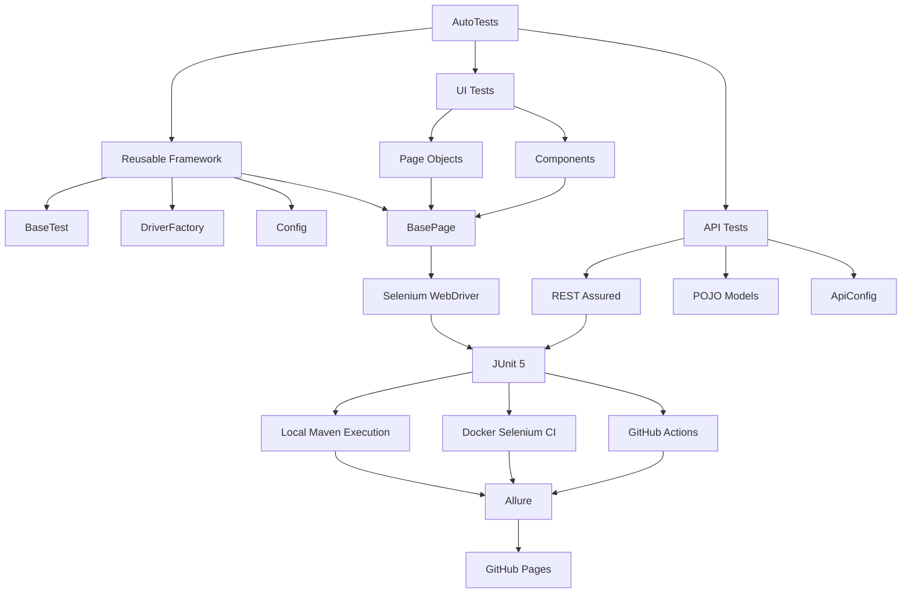

# AutoTests


A Java-based test automation project demonstrating UI and API testing, Page Object Model, reusable framework components, test categorization, Docker-based execution, GitHub Actions CI/CD, and Allure reporting.

The project uses [Demo Web Shop](https://demowebshop.tricentis.com/) as the main UI testing application and [JSONPlaceholder](https://jsonplaceholder.typicode.com/) for API testing.

## Architecture Overview



## About the Project

The project is structured so that reusable automation infrastructure is separated from application-specific test code.

### Reusable framework

The `framework` package contains the parts that can be reused when starting automation for another web application:

- `BaseTest`
- `BasePage`
- `DriverFactory`
- `Config`

The framework provides:

- WebDriver lifecycle management
- local Chrome execution
- remote Selenium execution
- configurable base URL
- configurable UI timeout
- reusable Selenium actions and waits

### Application-specific test code

The application-specific part contains:

- Page Objects
- UI components
- UI tests
- UI test data
- API configuration
- API tests
- API models
- API test data

This separation makes the project suitable as a starting point for new automation projects.

## Tech Stack

| Technology | Version | Purpose |
|---|---:|---|
| Java | 17+ | Programming language |
| Selenium WebDriver | 4.52.0 | UI test automation |
| JUnit | 5.10.2 | Test framework |
| Maven | — | Build and dependency management |
| REST Assured | 5.5.6 | REST API testing |
| Jackson Databind | 2.18.3 | JSON serialization/deserialization |
| Allure JUnit 5 | 2.29.1 | Test result integration |
| Allure CLI | 2.34.1 | CI report generation |
| Docker | — | Containerized execution |
| Docker Compose | — | Selenium environment orchestration |
| GitHub Actions | — | CI/CD |
| GitHub Pages | — | Allure report hosting |

> WebDriverManager is not used. Local Chrome execution relies on Selenium Manager provided by Selenium.

## Project Structure

```text
AutoTests/
│
├── .github/
│   └── workflows/
│       ├── allure-pages.yml
│       ├── ci-orchestrator.yml
│       ├── ci.yml
│       └── docker-ci.yml
│
├── src/
│   └── test/
│       └── java/
│           └── auto/
│               └── tests/
│                   │
│                   ├── api/
│                   │   ├── ApiConfig.java
│                   │   ├── ApiTest.java
│                   │   ├── model/
│                   │   │   ├── Post.java
│                   │   │   └── User.java
│                   │   └── testdata/
│                   │       └── ApiTestData.java
│                   │
│                   ├── cart/
│                   │   └── CartTest.java
│                   │
│                   ├── components/
│                   │   └── HeaderComponent.java
│                   │
│                   ├── framework/
│                   │   ├── base/
│                   │   │   └── BaseTest.java
│                   │   ├── config/
│                   │   │   └── Config.java
│                   │   ├── driver/
│                   │   │   └── DriverFactory.java
│                   │   └── pages/
│                   │       └── BasePage.java
│                   │
│                   ├── login/
│                   │   └── LoginTest.java
│                   │
│                   ├── pages/
│                   │   ├── CartPage.java
│                   │   ├── CheckoutPage.java
│                   │   ├── LoginPage.java
│                   │   └── RegistrationPage.java
│                   │
│                   ├── registration/
│                   │   └── RegistrationTest.java
│                   │
│                   └── testdata/
│                       └── TestData.java
│
├── Dockerfile
├── docker-compose.yml
├── pom.xml
├── .gitignore
└── README.md
```

## Framework Architecture

The UI automation follows this structure:

```text
Test Classes
     │
     ▼
Page Objects / Components
     │
     ▼
Framework BasePage
     │
     ▼
Selenium WebDriver
```

Driver creation is centralized in `DriverFactory`:

```text
BaseTest
    │
    └── DriverFactory.createDriver()
                    │
                    ├── Local → ChromeDriver
                    │
                    └── Remote → RemoteWebDriver
```

This keeps browser and execution-environment logic out of individual test classes.

## UI Test Coverage

The current project contains **31 UI tests**.

### Registration

The registration suite contains **11 tests** covering:

- successful registration
- empty registration form
- password mismatch
- invalid email
- missing first name
- missing last name
- missing email
- minimum valid password length
- password below the minimum length
- email containing spaces
- email using uppercase characters

### Login

The authentication suite contains **10 tests** covering:

- successful login
- empty login form
- incorrect password
- incorrect email
- empty email
- empty password
- password recovery with an invalid email
- password recovery with an existing email
- invalid email with an empty password
- logout

### Shopping Cart

The shopping cart suite contains **10 tests** covering scenarios such as:

- adding products to the cart
- checkout restrictions
- accepting Terms of Service
- configurable products
- multiple products
- adding the same product multiple times
- changing product quantity
- cart item counter
- product price validation
- subtotal calculation

Prices are handled with `BigDecimal` when calculations are required:

```java
BigDecimal expectedSubtotal =
        unitPrice.multiply(BigDecimal.valueOf(quantity));
```

This avoids using floating-point arithmetic for monetary values.

## API Testing

API automation is implemented using **REST Assured**.

The current API test application is:

```text
https://jsonplaceholder.typicode.com
```

The project contains **13 API tests**.

### Covered HTTP methods

```text
GET
POST
PUT
PATCH
DELETE
```

### API coverage includes

- HTTP status codes
- response body validation
- JSON fields
- response headers
- query parameters
- path parameters
- positive and negative scenarios
- POJO serialization/deserialization

API responses can be mapped to Java models:

```java
User responseUser = response.as(User.class);
```

The API-specific code is intentionally kept outside the reusable UI framework.

## Page Object Model

The project uses the Page Object Model to separate test scenarios from Selenium interaction logic.

Application-specific Page Objects include:

```text
RegistrationPage
LoginPage
CartPage
CheckoutPage
```

The reusable `BasePage` contains common Selenium operations such as:

```text
click()
type()
getText()
getAttribute()
findAll()
isDisplayed()
isSelected()
waitVisible()
waitInvisible()
waitClickable()
```

This provides:

- less duplicated Selenium code
- centralized locator interaction
- more readable tests
- easier maintenance
- separation between test logic and UI implementation

## Reusable Components

Common UI functionality is extracted into components when it is shared by multiple tests.

For the current application:

```text
HeaderComponent
```

contains common header actions such as:

- opening registration
- opening login
- opening the shopping cart
- logging out
- adding products to the cart
- reading the cart item counter

Application-specific components remain outside the reusable framework because they depend on the current application's UI.

## Explicit Waits

The framework uses Selenium `WebDriverWait` and `ExpectedConditions` instead of relying on fixed sleeps.

Examples:

```java
wait.until(ExpectedConditions.elementToBeClickable(locator));
```

```java
wait.until(ExpectedConditions.visibilityOfElementLocated(locator));
```

```java
wait.until(ExpectedConditions.invisibilityOfElementLocated(locator));
```

The default UI timeout is **10 seconds**.

The timeout can be overridden with:

```text
UI_TIMEOUT
```

For example:

```powershell
$env:UI_TIMEOUT="15"
mvn clean test
```

## Test Data

UI test data is stored separately from test classes:

```text
testdata/
└── TestData.java
```

Dynamic email addresses are generated with UUIDs so registration tests can create unique users.

Sensitive or environment-specific password values can be provided through environment variables:

```text
PASSWORD
SHORT_PASSWORD
INVALIDATE_PASSWORD
WRONG_PASSWORD
```

Default values are available for local execution.

For CI, the values are provided through GitHub Actions Secrets.

## Test Suites

Tests are categorized using JUnit 5 tags.

### Smoke

Smoke tests contain critical positive scenarios.

Run the Smoke suite:

```bash
mvn clean test -Dgroups=smoke
```

The current project contains **4 smoke tests**.

### Regression

Regression tests cover additional validation and negative scenarios.

Run the Regression suite:

```bash
mvn clean test -Dgroups=regression
```

The current project contains **7 regression-tagged tests**.

### Full Suite

Run all tests:

```bash
mvn clean test
```

## Test Distribution

The current `main` branch contains **44 active automated tests**:

| Area | Tests |
|---|---:|
| Registration | 11 |
| Login | 10 |
| Shopping Cart | 10 |
| API | 13 |
| **Total** | **44** |

The exact number of tests may change as new scenarios are added.

## Configuration

The reusable framework configuration is located in:

```text
src/test/java/auto/tests/framework/config/Config.java
```

### Base URL

The UI base URL can be configured using:

1. Java system property
2. environment variable
3. default value

The default value is:

```text
https://demowebshop.tricentis.com/
```

Example using an environment variable:

```powershell
$env:BASE_URL="https://example.com"
mvn clean test
```

Example using a Maven system property:

```bash
mvn clean test -DBASE_URL=https://example.com
```

### UI Timeout

The default UI timeout is:

```text
10 seconds
```

It can be overridden with:

```text
UI_TIMEOUT
```

### Browser and Remote Execution

The driver configuration uses:

```text
BROWSER
SELENIUM_REMOTE_URL
```

The current framework supports Chrome.

If `SELENIUM_REMOTE_URL` is set, `DriverFactory` creates a `RemoteWebDriver`. Otherwise, it creates a local `ChromeDriver`.

## Local Execution

### Requirements

Install:

- Java 17 or higher
- Maven
- Google Chrome
- Git

Docker is required only for containerized execution.

### Clone the repository

```bash
git clone https://github.com/crscntmn/AutoTests.git
cd AutoTests
```

### Run all tests

```bash
mvn clean test
```

### Run Smoke tests

```bash
mvn clean test -Dgroups=smoke
```

### Run Regression tests

```bash
mvn clean test -Dgroups=regression
```

## Docker Execution

The project supports running Selenium tests inside Docker.

Docker Compose starts two services:

```text
┌─────────────────────────────┐
│       Docker Compose        │
│                             │
│  ┌───────────────────────┐  │
│  │ Selenium Standalone   │  │
│  │ Chrome :4444          │  │
│  └───────────┬───────────┘  │
│              │              │
│              │ WebDriver    │
│              ▼              │
│  ┌───────────────────────┐  │
│  │      AutoTests        │  │
│  │        Maven          │  │
│  └───────────────────────┘  │
│                             │
└─────────────────────────────┘
```

The Selenium image is configurable and defaults to:

```text
selenium/standalone-chrome:latest
```

The test container connects to Selenium through:

```text
SELENIUM_REMOTE_URL=http://selenium:4444/wd/hub
```

### Run the full Docker suite

```bash
docker compose up --build
```

### Run Smoke tests in Docker

Linux/macOS:

```bash
TEST_GROUP=smoke docker compose up --build
```

PowerShell:

```powershell
$env:TEST_GROUP="smoke"
docker compose up --build
```

### Run Regression tests in Docker

Linux/macOS:

```bash
TEST_GROUP=regression docker compose up --build
```

PowerShell:

```powershell
$env:TEST_GROUP="regression"
docker compose up --build
```

### Configure UI timeout in Docker

PowerShell:

```powershell
$env:UI_TIMEOUT="15"
docker compose up --build
```

The Docker Compose configuration passes the following settings to the test container:

```text
SELENIUM_REMOTE_URL
BROWSER
UI_TIMEOUT
PASSWORD
SHORT_PASSWORD
INVALIDATE_PASSWORD
WRONG_PASSWORD
TEST_GROUP
```

## GitHub Actions CI/CD

The project uses GitHub Actions with reusable workflows.

The main workflow is:

```text
CI Orchestrator
```

It coordinates:

```text
                    CI Orchestrator
                           │
             ┌─────────────┴─────────────┐
             │                           │
             ▼                           ▼
       Selenium CI                 Docker Selenium CI
             │                           │
             ▼                           ▼
       Test Matrix                  Chrome Container
             │                           │
             └─────────────┬─────────────┘
                           ▼
                    Allure Reports
                           │
                           ▼
                     GitHub Pages
```

### Workflow triggers

The CI Orchestrator runs on:

- push to `main`
- push to `develop`
- pull request to `main`
- scheduled execution
- manual execution

The scheduled workflow runs daily.

### Manual execution

The workflow can be started manually from GitHub Actions.

Available suites:

```text
all
smoke
regression
```

This allows a specific test group to be executed without modifying the test code.

## Selenium CI Matrix

The Selenium CI workflow currently runs:

| Operating System | Java | Browser |
|---|---:|---|
| Ubuntu | 17 | Chrome |
| Ubuntu | 21 | Chrome |
| Windows | 17 | Chrome |
| Windows | 21 | Chrome |
| macOS | 17 | Chrome |
| macOS | 21 | Chrome |

The same test suite is therefore checked across multiple operating systems and Java versions.

## Docker CI

Docker CI currently runs Selenium Standalone Chrome.

The workflow:

1. builds the AutoTests image;
2. starts the Selenium container;
3. waits for Selenium to become ready;
4. runs the tests;
5. collects Surefire and Allure results;
6. publishes test artifacts;
7. fails the workflow if the Docker test run fails.

## Allure Reporting

The project uses:

- `allure-junit5` to collect test results;
- Allure CLI to generate reports in CI;
- GitHub Pages to publish the reports.

The Maven Allure plugin is not required by the current CI pipeline.

### Live Allure Reports

**[Open Allure Test Reports](https://crscntmn.github.io/AutoTests/)**

The published reports are organized into:

```text
Allure Reports
│
├── Selenium
│   ├── Ubuntu
│   │   ├── Java 17 / Chrome
│   │   └── Java 21 / Chrome
│   │
│   ├── Windows
│   │   ├── Java 17 / Chrome
│   │   └── Java 21 / Chrome
│   │
│   └── macOS
│       ├── Java 17 / Chrome
│       └── Java 21 / Chrome
│
└── Docker
    └── Chrome
```

## CI Artifacts

The CI workflows store test artifacts including:

- Maven Surefire reports
- Allure results
- generated Allure reports

These artifacts can be used to investigate failed test executions after a workflow finishes.

## Reusing the Framework for a New Project

The framework was structured with reuse in mind.

A typical workflow for starting automation for another web application is:

```text
1. Clone repository
       ↓
2. Change BASE_URL / Config default
       ↓
3. Remove application-specific Page Objects and tests
       ↓
4. Create new Page Objects
       ↓
5. Add application-specific test data
       ↓
6. Add new UI tests
       ↓
7. Run locally with Maven
       ↓
8. Run in Docker
       ↓
9. Run through GitHub Actions
       ↓
10. Review Allure reports
```

The reusable infrastructure normally does not need to be changed when switching to another ordinary web application.

The main project-specific parts that are expected to change are:

- Page Objects
- UI components
- test classes
- test data
- API tests and models, when API coverage is needed
- application URL/configuration

Special client requirements such as authentication infrastructure, proxy configuration, certificates, unusual browsers, or external services may require additional CI/Docker configuration.

## Framework Design Principles

The project follows several practical principles:

- Page Object Model
- separation of framework and application-specific code
- reusable Selenium operations
- explicit waits
- centralized configuration
- centralized test data
- dynamic test data generation
- JUnit 5 test tags
- Maven-based execution
- Docker-based execution
- reusable GitHub Actions workflows
- automated Allure reporting
- cross-platform CI validation
- avoiding unnecessary framework complexity

The goal is to keep the framework simple enough to adapt to a new client project without introducing unnecessary abstractions.

## Known Limitations

This repository is a demonstration automation project built around publicly available applications.

The UI tests depend on the current behavior and availability of:

```text
https://demowebshop.tricentis.com/
```

API tests depend on:

```text
https://jsonplaceholder.typicode.com/
```

The current driver configuration supports Chrome only.

Browser, WebDriver, operating-system, and CI behavior can vary depending on the environment and browser version.

Docker CI currently focuses on Selenium Standalone Chrome.

## Project Goals

The project demonstrates practical skills in:

- UI test automation
- API test automation
- Java
- Selenium WebDriver
- JUnit 5
- Page Object Model
- test data management
- smoke testing
- regression testing
- boundary value testing
- REST Assured
- Docker
- Docker Compose
- GitHub Actions
- CI/CD
- Allure reporting
- cross-platform test execution
- reusable automation framework design

## Author

**Semyon**

QA Engineer focused on:

- Manual Testing
- UI Test Automation
- Java
- Selenium WebDriver
- REST API Testing
- JUnit 5
- Docker
- CI/CD
- GitHub Actions
- Allure

## Links

- **Repository:** https://github.com/crscntmn/AutoTests
- **Allure Reports:** https://crscntmn.github.io/AutoTests/
- **Demo Web Shop:** https://demowebshop.tricentis.com/
- **JSONPlaceholder:** https://jsonplaceholder.typicode.com/

## Project Status

The framework is ready to be extended with additional:

- UI scenarios
- API scenarios
- Page Objects
- reusable components
- test data
- CI/CD scenarios
- reporting improvements
